<div align="center">

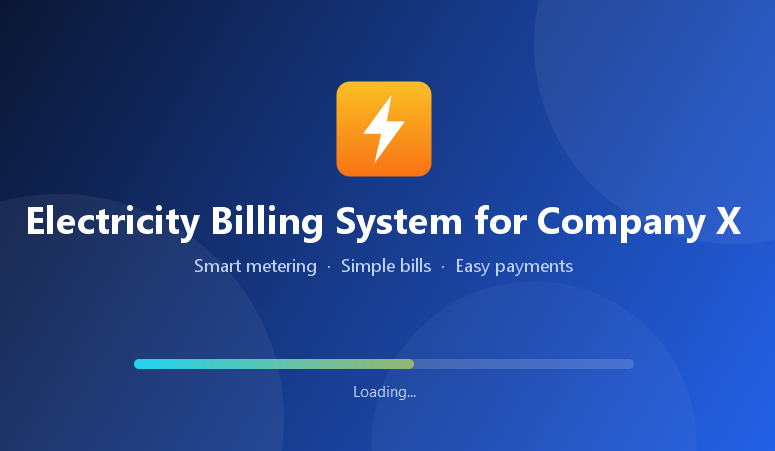

# ⚡ Electricity Billing System for Company X

**A clean, modern desktop app for managing customers, meters, bills and payments.**
Built with Java Swing. No database server, no extra libraries, just a JSON file.


[Features](#-features) •
[Screenshots](#-screenshots) •
[Quick start](#-quick-start) •
[How it works](#-how-it-works) •
[Data format](#-data-format) •
[Customize](#-customize) •
[Roadmap](#-roadmap)

</div>

---

## ✨ Features

<table>
<tr>
<td width="50%" valign="top">

### 🛠️ For admins
- Register customers and their meters in two quick steps
- Auto-generated meter numbers
- Create monthly bills from the tariff table
- Search and print customer records
- Review every bill and its payment status
- Dashboard with customers, bills issued, unpaid bills and amount due

</td>
<td width="50%" valign="top">

### 👤 For customers
- Sign up with the meter number the admin created
- View a clear bill for any month
- Pay a bill with a **bKash** popup
- See all bills in one table, with Paid / Not Paid highlighted
- View and update contact details

</td>
</tr>
</table>

**Also:**
🎨 one shared design system &nbsp;•&nbsp; 💾 zero-setup database &nbsp;•&nbsp; 🔐 masked password field &nbsp;•&nbsp; 🧮 built-in Notepad and Calculator shortcuts (Windows)

---

## 📸 Screenshots

<table>
<tr>
<td align="center" width="50%">
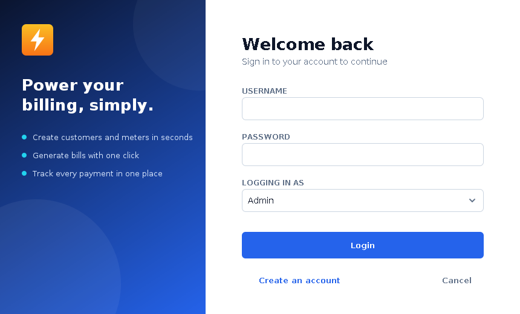<br>
<sub><b>Login</b></sub>
</td>
<td align="center" width="50%">
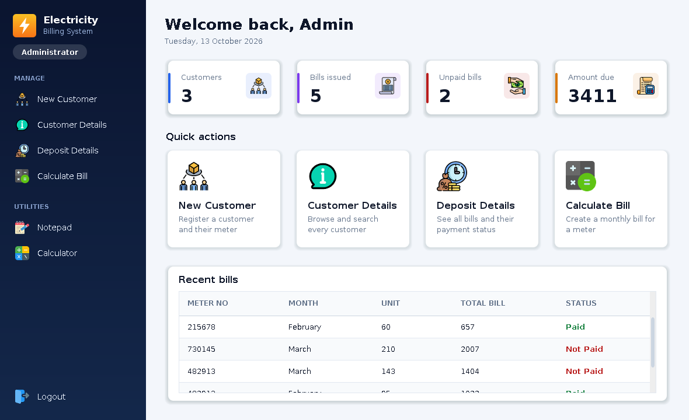<br>
<sub><b>Admin dashboard</b></sub>
</td>
</tr>
<tr>
<td align="center">
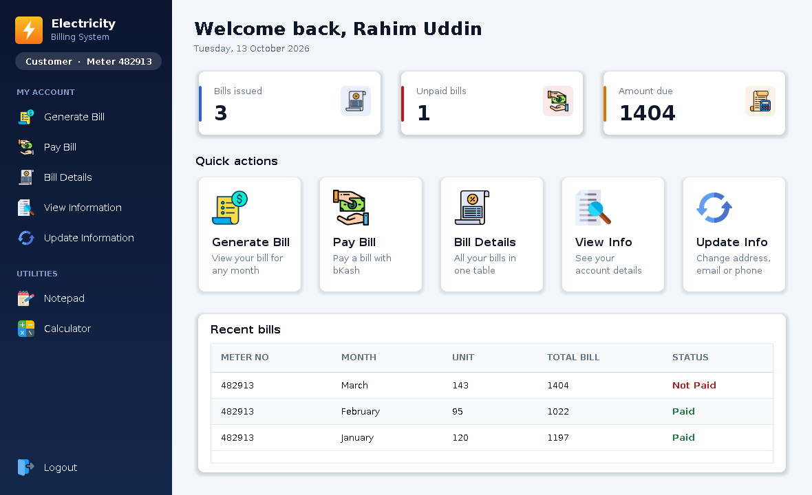<br>
<sub><b>Customer dashboard</b></sub>
</td>
<td align="center">
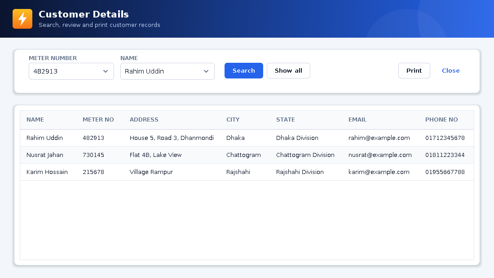<br>
<sub><b>Customer details</b></sub>
</td>
</tr>
<tr>
<td align="center">
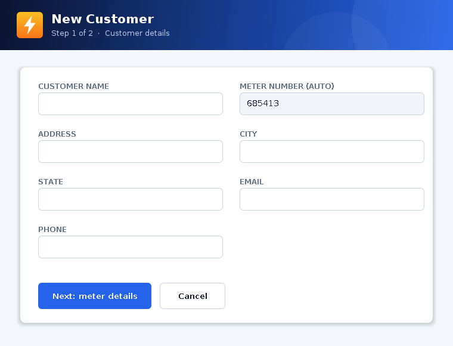<br>
<sub><b>New customer</b></sub>
</td>
<td align="center">
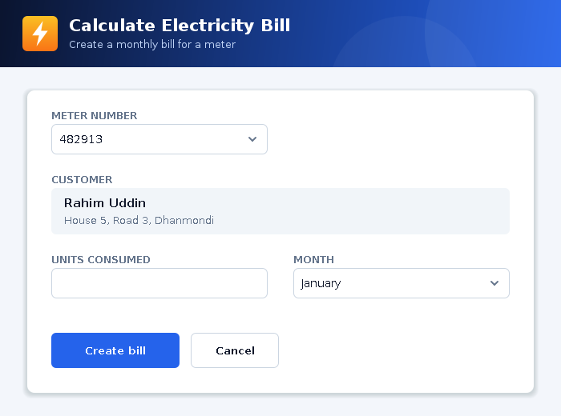<br>
<sub><b>Calculate bill</b></sub>
</td>
</tr>
<tr>
<td align="center">
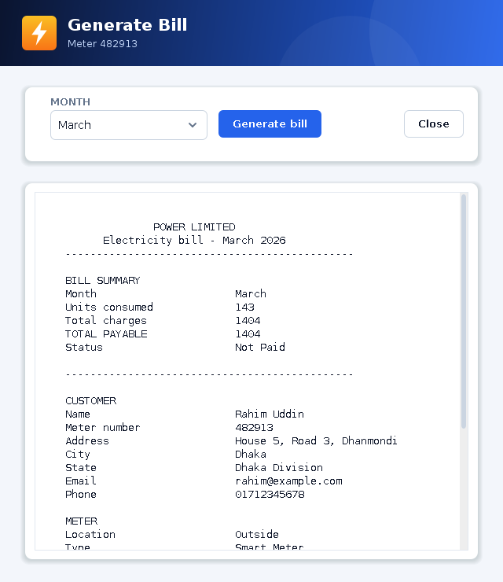<br>
<sub><b>Generate bill</b></sub>
</td>
<td align="center">
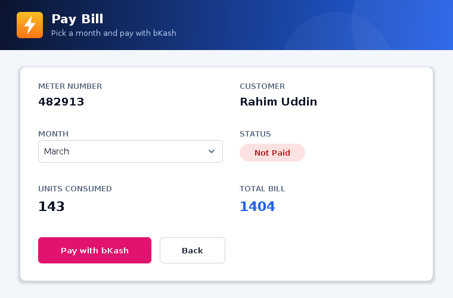<br>
<sub><b>Pay bill</b></sub>
<br><br>
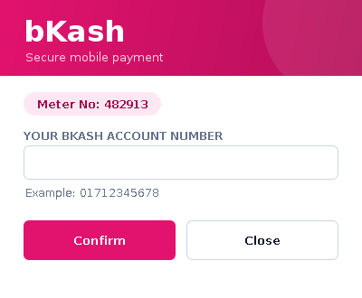<br>
<sub><b>bKash popup</b></sub>
</td>
</tr>
</table>

---

## 🚀 Quick start

### 1. Requirements

| Tool | Version |
|---|---|
| **JDK** | 17 or newer ([Temurin](https://adoptium.net) works well) |
| **VS Code** *(optional)* | with the **Extension Pack for Java** by Microsoft |

Check Java in a terminal: `java -version` and `javac -version`.

### 2. Get the code

```bash
git clone https://github.com/ARShourov/Electricity-Billing-System-for-Company-X.git
cd Electricity-Billing-System-for-Company-X
```

### 3. Run it

**In VS Code**

1. `File → Open Folder…` and pick the project folder.
2. Wait for the Java spinner in the status bar to finish.
3. Open `src/electricity/billing/system/Splash.java` and click **Run** above `main`, or press **F5**.

**From a terminal**

```bash
# Windows
run.bat

# macOS / Linux
./run.sh
```

### 4. Log in

| Role | Username | Password |
|---|---|---|
| Admin | `admin` | `admin123` |

> 🔒 **Change the sample admin password** in `data/bill_system.json` before using the app for anything real.

### A first walkthrough

1. Log in as **Admin** → **New Customer** → fill in the form → **Next** → pick the meter details → **Submit**. Note the meter number.
2. **Calculate Bill** → choose the meter, enter the units and a month → **Create bill**.
3. **Logout** → **Create an account** → choose **Customer**, type the meter number, pick a username and password.
4. Log in as the customer → **Generate Bill**, **Pay Bill**, **Bill Details**…

---

## 🧠 How it works

The screens still talk to a normal JDBC-style `Connection / Statement / ResultSet`. Behind that API, a small SQL engine keeps everything in one JSON file, so there is nothing to install or configure.

<table>
<tr>
<td align="center" width="50%">
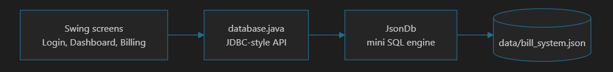<br>
<sub><b>Overall engine concept</b></sub>
</td>
</tr>
</table>

And the data flows like this:

<table>
<tr>
<td align="center" width="50%">
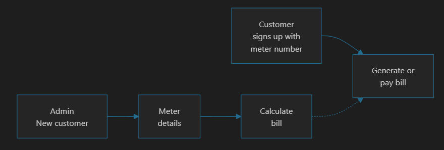<br>
<sub><b>Data flow diagram</b></sub>
</td>
</tr>
</table>

### 🧮 How a bill is calculated

```
total = units × cost_per_unit + meter_rent + service_charge + fixed_tax
```

With the sample tariff, **100 units** gives `100 × 9 + 47 + 22 + 42 = 1011`.

---

## 💾 Data format

Everything lives in `data/bill_system.json`. It is re-read on every query, so you can open it in any editor. It is created automatically (with an admin account and a sample tariff) if it does not exist.

| Table | Columns |
|---|---|
| `Signup` | `meter_no`, `username`, `name`, `password`, `usertype` |
| `new_customer` | `name`, `meter_no`, `address`, `city`, `state`, `email`, `phone_no` |
| `meter_info` | `meter_number`, `meter_location`, `meter_type`, `phase_code`, `bill_type`, `Days` |
| `bill` | `meter_no`, `month`, `unit`, `total_bill`, `status` |
| `tax` | `cost_per_unit`, `meter_rent`, `service_charge`, `service_tax`, `fixed_tax` |

<details>
<summary><b>Example</b></summary>

```json
{
  "Signup": [
    {
      "meter_no": "0",
      "username": "admin",
      "name": "Administrator",
      "password": "admin123",
      "usertype": "Admin"
    }
  ],
  "new_customer": [],
  "meter_info": [],
  "bill": [
    {
      "meter_no": "482913",
      "month": "March",
      "unit": "100",
      "total_bill": "1017",
      "status": "Not Paid"
    }
  ],
  "tax": [
    {
      "cost_per_unit": "9",
      "meter_rent": "47",
      "service_charge": "22",
      "service_tax": "57",
      "fixed_tax": "42"
    }
  ]
}
```

</details>

**Tips**
- 🔄 Delete the file to reset the app to a clean state.
- 👑 Add another admin by adding a row to `Signup` with `"usertype": "Admin"`.
- 📁 Keep the data elsewhere: run with `-Dbilling.db=C:/path/bill_system.json`.

---

## 🎨 Customize

| I want to… | Do this |
|---|---|
| Change the colour scheme | Edit `BLUE` and `NAVY_DEEP` at the top of `Theme.java` |
| Change the tariff | Edit the row in the `tax` table of the JSON file |
| Use a different font | Run with `-Dbilling.font="Your Font"` (defaults to Segoe UI where available) |

---

## 📁 Project structure

```
Electricity-Billing-System/
├── .vscode/                    launch + project settings for VS Code
├── data/
│   └── bill_system.json        the "database"
├── docs/screenshots/           images used in this README
├── src/
│   ├── electricity/billing/system/
│   │   ├── Theme.java          colours, fonts, buttons, fields, cards, tables
│   │   ├── Screen.java         base class for every window
│   │   ├── Splash, Login, Signup, main_class (dashboard)
│   │   ├── newCustomer, meterInfo, calculate_bill
│   │   ├── customer_details, deposit_details, bill_details
│   │   ├── generate_bill, pay_bill, payment_bill (bKash popup)
│   │   ├── update_information, view_information
│   │   └── database.java, JsonDb.java    JSON storage behind a JDBC-style API
│   ├── net/proteanit/sql/DbUtils.java    result set → table model
│   └── icon/                   images
├── run.bat · run.sh            compile and start
└── README.md
```

---

## ⚠️ Good to know

- **bKash is a simulated screen.** It validates a Bangladeshi mobile number (`01[3-9]xxxxxxxx`, with or without `+880`) but moves no money. A real payment needs bKash merchant API credentials; hook it into the **Confirm** button in `payment_bill.java`.
- **Passwords are stored as plain text** in the JSON file. Fine for learning and demos, not for production.
- The bill total does not include `service_tax` (it is stored and shown on the bill, but not added).
- The JSON engine supports exactly what the app uses: `select * from … where a = 'x' and b = 'y'`, `insert` and `update`. A name containing an apostrophe (O'Brien) is a SQL syntax error.
- The Notepad and Calculator shortcuts open Windows programs.
- Single-user, single-machine design.

---

## 🗺️ Roadmap

- [ ] Real bKash payment (Tokenized Checkout API)
- [ ] Password hashing
- [ ] Include `service_tax` in the bill total
- [ ] Export bills as PDF
- [ ] Dark mode
- [ ] Automated tests

Ideas and pull requests are welcome.

---

## 🤝 Contributing

1. Fork the repository
2. Create a branch: `git checkout -b feature/my-idea`
3. Commit your changes: `git commit -m "Add my idea"`
4. Push and open a pull request

---

## 🙏 Acknowledgements

Based on an open-source *Electricity Billing System* (Java Swing + MySQL) project. This version adds a redesigned interface, a JSON storage layer and a bKash payment popup.

---

<div align="center">

Made with ☕ and full of ⚡ by **AR Shourov**

If this project helped you, consider giving it a ⭐

</div>
